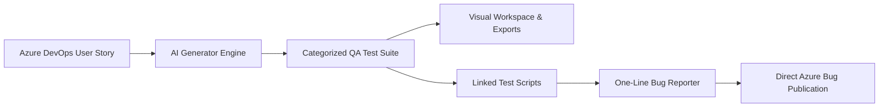
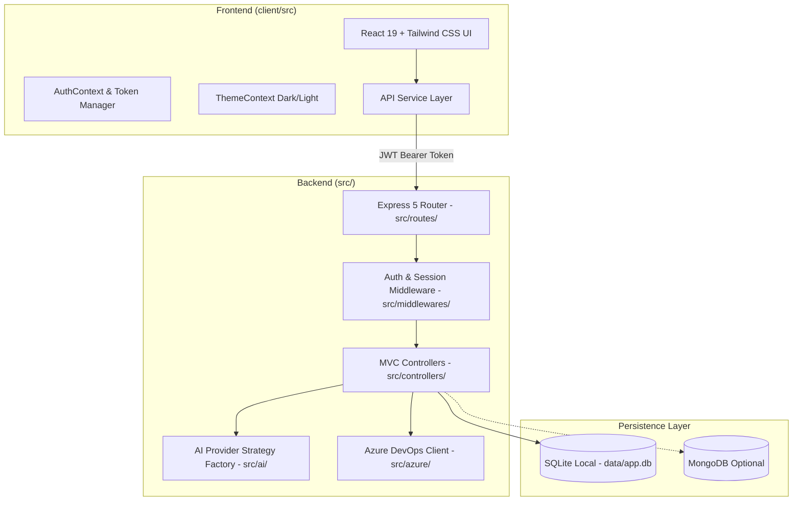

# QA Test Case Generator & Bug Reporter Tool — Comprehensive Application Functionality

An enterprise-ready, AI-driven Quality Assurance platform integrating **Azure DevOps** and **Multi-Model AI Providers** (Google Gemini, OpenAI, OpenRouter) to automatically generate structured QA test suites, convert one-line bug summaries into detailed bug reports, and directly publish bugs with evidence attachments to Azure DevOps.

---

## 📑 Table of Contents

1. [Executive Summary](#-executive-summary)
2. [High-Level System Architecture](#-high-level-system-architecture)
3. [Core Capabilities & Functional Modules](#-core-capabilities--functional-modules)
   - [1. Authentication, Sessions & Security](#1-authentication-sessions--security)
   - [2. Azure DevOps Deep Integration](#2-azure-devops-deep-integration)
   - [3. Multi-Model AI Engine](#3-multi-model-ai-engine)
   - [4. AI QA Test Suite Generator](#4-ai-qa-test-suite-generator)
   - [5. Test Suite Visualizer & Workspace](#5-test-suite-visualizer--workspace)
   - [6. Export & Clipboard Utilities](#6-export--clipboard-utilities)
   - [7. Historical Test Suite Management](#7-historical-test-suite-management)
   - [8. AI Bug Reporter & Azure Publisher](#8-ai-bug-reporter--azure-publisher)
   - [9. Script Linking & Test Scenarios Catalog](#9-script-linking--test-scenarios-catalog)
   - [10. Profile & Azure Credentials Configuration](#10-profile--azure-credentials-configuration)
   - [11. Modern UI/UX, Themes & Responsive Design](#11-modern-uiux-themes--responsive-design)
4. [Dual-Engine Data Persistence Layer](#-dual-engine-data-persistence-layer)
5. [Backend API Reference](#-backend-api-reference)
6. [Frontend Component Architecture](#-frontend-component-architecture)
7. [End-to-End User Workflows](#-end-to-end-user-workflows)
8. [Configuration & Environment Variables](#-configuration--environment-variables)

---

## 🌟 Executive Summary

The **QA Test Case Generator & Bug Reporter** transforms requirement documents and user stories into exhaustive, categorized test suites in seconds. It bridges the gap between project planning (Azure DevOps) and QA testing by automating test case derivation, defect documentation, and Azure work item lifecycle management.



---

## 🏛 High-Level System Architecture

The application strictly follows an **MVC (Model-View-Controller)** pattern on the backend and a component-driven **React 19 + Tailwind CSS** architecture on the frontend.



---

## 🚀 Core Capabilities & Functional Modules

### 1. Authentication, Sessions & Security
- **User Registration & Login:** Full user signup and signin workflow (`/api/auth/register`, `/api/auth/login`).
- **Cryptographic Security:** Passwords hashed using standard **PBKDF2** with individual cryptographic salt generation (`1000 iterations, 64-byte key, sha512`).
- **Token-Based Sessions & Rotation:**
  - Short-lived Access Tokens (15-minute expiration).
  - Long-lived Refresh Tokens (7-day expiration).
  - Automatic silent refresh mechanism (`/api/auth/refresh`) on the frontend (`api.js` + `tokenManager.js`).
  - Refresh token rotation and instant revocation on logout (`/api/auth/logout`).
- **Data Protection at Rest:**
  - Sensitive Azure Personal Access Tokens (PATs) are encrypted at rest using **AES-256-GCM** with 16-byte random IVs and authentication tags (`src/utils/cryptoUtils.js`).
  - Transparent decryption occurs only during authorized backend Azure API requests.
- **Account Scoping:** All generated test suites, bugs, and profile configurations are strictly partitioned by authenticated user ID.

---

### 2. Azure DevOps Deep Integration
The platform interacts with Azure DevOps REST API v7.0 dynamically using either individual user credentials (PAT) or system-wide fallbacks:
- **Organization & Project Discovery:**
  - Automatically fetches all projects accessible by the authenticated user (`/api/azure/projects`).
- **User Story & Backlog Extraction:**
  - Executes targeted **WIQL** (Work Item Query Language) queries to list active User Stories and Product Backlog Items (PBIs) for any chosen project (`/api/azure/work-items`).
- **Detailed Work Item Parsing:**
  - Retrieves work item metadata, state, assigned user, description, and acceptance criteria.
  - Cleans and strips raw HTML and HTML entities (`cleanHtml`) into readable plain text for accurate AI comprehension (`/api/azure/work-item/:id`).
- **Iteration / Sprint Fetching:**
  - Discovers sprint paths and active iterations for linking defects accurately (`/api/azure/iterations`).
- **Team Members & Users Lookup:**
  - Resolves team members using Azure Team Member REST APIs with automatic fallback to the Azure Graph API (`/api/azure/users`).
- **Evidence Attachment Upload:**
  - Uploads binary attachments (screenshots, images) directly via Azure DevOps Attachment API (`/apis/wit/attachments`) for embedding in bug reports.
- **Bug Work Item Creation & Relationship Linking:**
  - Creates Bug work items with formatted HTML reproduction steps, severity levels, iteration paths, and assignee.
  - Automatically establishes parent-child hierarchy links (`System.LinkTypes.Hierarchy-Reverse`) connecting the bug back to its original User Story.
  - Appends external hyperlinks or embedded attachments.

---

### 3. Multi-Model AI Engine
The backend features an extensible Strategy/Factory pattern (`src/ai/providers/factory.js`) supporting multiple AI backends:

| Provider | Supported Models | Primary Characteristics |
| :--- | :--- | :--- |
| **Google Gemini** | `gemini-3.6-flash`, `gemini-2.5-flash`, `gemini-1.5-pro` | Fast inference, structured JSON output, official `@google/genai` SDK |
| **OpenAI** | `gpt-4o`, `gpt-4o-mini`, `gpt-4-turbo` | High accuracy, standard OpenAI client |
| **OpenRouter** | `meta-llama/llama-4-maverick`, `anthropic/claude-3.5-sonnet`, `deepseek/deepseek-r1` | Broad multi-vendor access, unified OpenAI-compatible endpoint |

#### Key AI Highlights:
- **Zero-Preamble JSON Enforcement:** Prompts mandate strict JSON structure without markdown fencing leaks.
- **Resilience & Rate-Limit Fallback:** If AI providers return `429 Too Many Requests` or quota exhaustion, the engine gracefully transitions to an offline QA template generator without crashing.
- **Sanitized Error Messaging:** Backend converts raw SDK stack traces and HTTP codes into actionable user tips (`errorFormatter.js`).

---

### 4. AI QA Test Suite Generator
Converts Azure DevOps User Stories into full-fledged QA test suites (`src/ai/testCaseGenerator.js`):
- **Requirement Verification:** Validates that the work item has meaningful acceptance criteria and title before consuming AI tokens.
- **Categorized Test Coverage:** Produces discrete sections covering:
  - Positive / Functional Scenarios
  - Negative & Validation Scenarios
  - Edge & Boundary Cases
  - Security, Authentication & Permissions
  - UI / UX & Responsive Behaviors
  - Performance & Data Persistence
- **Exhaustive Output Format:**
  ```json
  {
    "feature": "User Profile Management",
    "sections": [
      {
        "name": "Password Reset Flow",
        "testCases": [
          "Verify user receives a reset token email when entering valid registered email",
          "Verify expired reset token displays friendly error message"
        ]
      }
    ]
  }
  ```

---

### 5. Test Suite Visualizer & Workspace
The frontend offers an interactive testing workspace:
- **Dual View Modes:**
  - **Visual Mode:** Rich collapsible cards grouped by section (`SectionCard.jsx`), complete with individual test case count badges and copy actions.
  - **JSON Mode:** Syntax-highlighted raw JSON viewer (`JsonViewer.jsx`) for technical audits and API pipeline integrations.
- **Real-Time Search & Filtering:** Live text search filtering sections and highlighting matching test scenarios as you type.
- **Accordion Controls:** "Expand All" and "Collapse All" toggle buttons for rapid navigation across dozens of sections.
- **Visual Metadata Banner:** Displays the feature title, total section count, and aggregate test case tally.

---

### 6. Export & Clipboard Utilities
Built-in tools to facilitate QA sharing and reporting (`Toolbar.jsx`):
- **Copy All to Markdown:** Formats the entire test suite into formatted GitHub-flavored Markdown text.
- **Copy Raw JSON:** Instantly copies formatted JSON directly to clipboard.
- **Download JSON (`.json`):** Generates and downloads a clean JSON file named after the feature.
- **Download CSV (`.csv`):** Exports an Excel-compatible CSV file with UTF-8 BOM encoding (`Feature`, `Section`, `Test Case ID`, `Test Case`).

---

### 7. Historical Test Suite Management
Every generated suite is saved to the user's database history (`HistoryDrawer.jsx`):
- **Slide-Over History Panel:** View previously generated suites with timestamp, feature name, section count, and test count.
- **Instant Workspace Reload:** Click any historical entry to load it directly back into the active visual workspace without regenerating or expending AI credits.
- **Per-User Isolation:** Users only see test suites generated within their own account.

---

### 8. AI Bug Reporter & Azure Publisher
A defect reporting modal (`BugReporterModal.jsx`):
- **One-Line Bug Input:** QA testers enter a quick summary (e.g., *"Save button spins infinitely when email field has trailing whitespace"*).
- **AI Enhancement:** The AI ingests the bug summary, parent user story context, and linked test scenario to produce a complete bug report:
  - Professional Title
  - Calculated Severity (`1 - Critical`, `2 - High`, `3 - Medium`, `4 - Low`)
  - Impact Description
  - Numbered Steps to Reproduce
  - Expected Result
  - Actual Result
- **Offline Template Engine:** When AI is not desired or quota is limited, an instant keyword-driven offline template generates structured reports in 0ms without network overhead.
- **Screenshot & Media Evidence:**
  - Drag-and-drop or file upload for screenshot images (`.png`, `.jpg`).
  - Direct paste from clipboard support.
  - Video or screen-recording URL link support.
- **Live Review & Full Editing:** Testers can inspect and modify all generated fields, severity levels, assignees, and sprint iterations prior to publication.
- **Direct 1-Click Azure DevOps Publishing:** Publishes the bug directly into Azure DevOps as a native `$Bug` work item linked to the parent story and assigned team member.
- **Local Bug Record:** Stores the published or draft bug in the local database for historical tracking.

---

### 9. Script Linking & Test Scenarios Catalog
- **Test Scripts Catalog API (`/api/scripts`):** Extracts all individual test cases across all generated test suites in the database.
- **Searchable Script Selector:** When reporting a bug, testers can search and link the exact test case that failed during execution.
- **Contextual Prompting:** The selected test case is injected into the AI prompt so the generated reproduction steps specifically reproduce that exact scenario.

---

### 10. Profile & Azure Credentials Configuration
A centralized settings hub (`ProfileModal.jsx`):
- **Azure DevOps Credentials:**
  - Organization Name configuration.
  - Personal Access Token (PAT) input with mask toggle.
  - Immediate visual badge verifying whether Azure credentials are fully configured.
- **User Account Information:** Displays User ID, Username, Email, and Role.
- **Dynamic Onboarding Alert:** Persistent dashboard alert guiding new users to configure their Azure PAT to unlock live project browsing.

---

### 11. Modern UI/UX, Themes & Responsive Design
- **Theme Support:** Dark Theme and Light Theme with smooth instant transitions (`ThemeContext.jsx`).
- **Glassmorphism & Micro-Interactions:** Backdrop blur panels, subtle gradient borders, and active scale animations powered by **Framer Motion**.
- **Collapsible Sidebar:** Left panel can be collapsed to maximize test viewing real estate on smaller screens.
- **Searchable Dropdowns:** Custom search-as-you-type selectors (`SearchableSelect.jsx`) for projects, stories, team members, iterations, and test scripts.
- **Toast Notification System:** Non-intrusive floating toasts for copy confirmations, errors, and success updates (`Toast.jsx`).

---

## 💾 Dual-Engine Data Persistence Layer

The backend includes a storage abstraction supporting both local embedded databases and cloud NoSQL databases:

```text
src/config/
├── db.js       # SQLite3 connection, schema initialization, and migration layer
└── mongo.js    # MongoDB connection pool (optional cloud synchronization)
```

### Database Tables & Schemas

| Table | Primary Key | Key Attributes | Notes |
| :--- | :--- | :--- | :--- |
| `users` | `id` (UUID) | `username`, `email`, `name`, `role`, `hash`, `salt`, `azure_org`, `azure_pat` | `azure_pat` is encrypted at rest using AES-256-GCM |
| `test_suites` | `id` (UUID) | `user_id`, `work_item_id`, `feature_name`, `data_json`, `file_name`, `created_at` | Stores full JSON payload of generated test cases |
| `bugs` | `id` (UUID) | `user_id`, `work_item_id`, `title`, `severity`, `description`, `steps_to_reproduce`, `expected_result`, `actual_result`, `azure_bug_id`, `assigned_to`, `media_url` | Tracks reported bugs and Azure DevOps work item IDs |

---

## 🔌 Backend API Reference

All protected endpoints require an `Authorization: Bearer <token>` header.

### 1. Authentication Endpoints (`/src/routes/authRoutes.js`)
- `POST /api/auth/register` — Create new user account.
- `POST /api/auth/login` — Authenticate and receive access + refresh token pair.
- `POST /api/auth/refresh` — Exchange refresh token for fresh access token.
- `POST /api/auth/logout` — Revoke access and refresh tokens.
- `GET /api/auth/me` — Retrieve current authenticated user profile.
- `PUT /api/user/profile` — Update user profile and Azure credentials.

### 2. Azure DevOps Endpoints (`/src/routes/azureRoutes.js`)
- `GET /api/config` — Check Azure configuration status and default AI provider.
- `GET /api/azure/projects` — Fetch accessible Azure DevOps projects.
- `GET /api/azure/work-items?project=<name>` — List active User Stories / PBIs in project.
- `GET /api/azure/work-item/:id` — Retrieve full work item details.
- `GET /api/azure/iterations?project=<name>` — List project sprint iteration paths.
- `GET /api/azure/users?project=<name>` — List project team members.

### 3. Test Suite Endpoints (`/src/routes/testSuiteRoutes.js`)
- `POST /api/generate` — Generate QA test suite via AI for an Azure work item.
- `GET /api/history` — List historical test suites generated by the user.
- `GET /api/history/:id` — Retrieve specific historical test suite JSON.
- `GET /api/scripts` — List all individual test scenarios for bug linking.

### 4. Bug Management Endpoints (`/src/routes/bugRoutes.js`)
- `POST /api/bugs/generate` — Generate structured bug report from summary and context.
- `POST /api/bugs/publish` — Publish bug to Azure DevOps and save locally.
- `GET /api/bugs` — List all bugs reported by current user.

---

## 🧩 Frontend Component Architecture

```text
client/src/
├── components/
│   ├── AuthView.jsx             # Login & Registration authentication forms
│   ├── Header.jsx               # Top bar with logo, Azure status, theme toggle & action buttons
│   ├── Sidebar.jsx              # Project & Story selector, AI provider & model selection
│   ├── FeatureBanner.jsx        # Suite header metrics, platforms, and view mode tabs
│   ├── Toolbar.jsx              # Search input, expand/collapse, copy & export actions
│   ├── SectionCard.jsx          # Collapsible test section card with test scenario items
│   ├── JsonViewer.jsx           # Formatted JSON tree viewer
│   ├── HistoryDrawer.jsx        # Slide-over historical test suite explorer
│   ├── ProfileModal.jsx         # User profile and Azure PAT settings modal
│   ├── BugReporterModal.jsx     # AI one-line bug logger and Azure publisher modal
│   ├── SearchableSelect.jsx     # Filterable dropdown select component
│   └── Toast.jsx                # Global notification toast
├── context/
│   ├── AuthContext.jsx          # Session state, tokens, user data, login/logout handlers
│   └── ThemeContext.jsx         # Dark / Light theme state manager
├── services/
│   ├── api.js                   # Authenticated HTTP client with auto-refresh retry
│   ├── apiError.js              # Friendly error messages and response parser
│   └── tokenManager.js          # Silent access token renewal logic
└── hooks/
    └── useToast.js              # Reusable toast trigger hook
```

---

## 🔄 End-to-End User Workflows

### Workflow A: Generating a QA Test Suite
1. **Log In:** User registers or logs in with their account.
2. **Configure Azure:** Adds Azure Organization Name and Personal Access Token in Profile.
3. **Select Work Item:** In the Sidebar, selects an Azure Project and picks a User Story from the dropdown (or enters a Work Item ID manually).
4. **Choose AI Model:** Selects AI provider (Gemini, OpenAI, OpenRouter) and model.
5. **Generate:** Clicks **"Generate Test Suite"**.
6. **Inspect & Search:** Explores sections (Functional, Boundary, Security, UI) in Visual or JSON mode.
7. **Export:** Copies test cases to clipboard as Markdown or downloads as `.csv` or `.json`.

### Workflow B: Logging a Bug with AI & Publishing to Azure
1. **Trigger Reporter:** Tester clicks **"Log Bug"** in the header or from a test failure.
2. **Context Selection:** Project and parent story are automatically populated; tester can optionally select the exact test scenario script that failed.
3. **Describe Bug:** Tester inputs a brief one-line description (e.g. *"Dropdown does not close when clicking outside"*).
4. **Attach Evidence:** Pastes or uploads a screenshot or enters a video URL.
5. **Generate AI Report:** AI constructs detailed Description, Steps to Reproduce, Expected Result, and Actual Result with inferred Severity.
6. **Review & Adjust:** Tester reviews the report, selects the target Sprint iteration, and assigns a developer.
7. **Publish:** Clicks **"Publish to Azure DevOps"**. The bug is immediately created in Azure DevOps, linked as a child to the story, and saved in the local database.

---

## ⚙️ Configuration & Environment Variables

Create a `.env` file in the project root:

```env
# Server Configuration
PORT=5000

# Security Keys
ENCRYPTION_KEY=your_32_byte_hex_or_passphrase_for_pat_encryption

# Azure DevOps Defaults (Optional fallback if user profile is unset)
AZURE_DEVOPS_ORG=your_org_name
AZURE_DEVOPS_PROJECT=your_project_name
AZURE_DEVOPS_PAT=your_azure_personal_access_token

# AI Provider Strategy Selection ('gemini', 'openai', or 'openrouter')
AI_PROVIDER=gemini
AI_MODEL=gemini-3.6-flash

# Google Gemini Credentials
GEMINI_API_KEY=your_gemini_api_key
GEMINI_MODEL=gemini-3.6-flash

# OpenAI Credentials
OPENAI_API_KEY=your_openai_api_key
OPENAI_MODEL=gpt-4o

# OpenRouter Credentials
OPENROUTER_API_KEY=your_openrouter_api_key
OPENROUTER_MODEL=meta-llama/llama-4-maverick
OPENROUTER_BASE_URL=https://openrouter.ai/api/v1

# Storage Configuration
OUTPUT_DIR=output
# MONGODB_URI=mongodb://localhost:27017/qa_generator  # Optional
```

---

## 🏁 Summary

The **QA Test Case Generator & Bug Reporter** offers an end-to-end testing pipeline:
- **Intelligent:** Derives full QA test coverage from Azure DevOps stories automatically.
- **Fast:** Converts single-line bug summaries into structured bug reports in seconds.
- **Connected:** Native Azure DevOps synchronization for projects, stories, team members, iterations, and bug creation.
- **Flexible:** Supports multiple AI providers, dark/light modes, Markdown/CSV/JSON exports, and hybrid SQLite/MongoDB storage.
